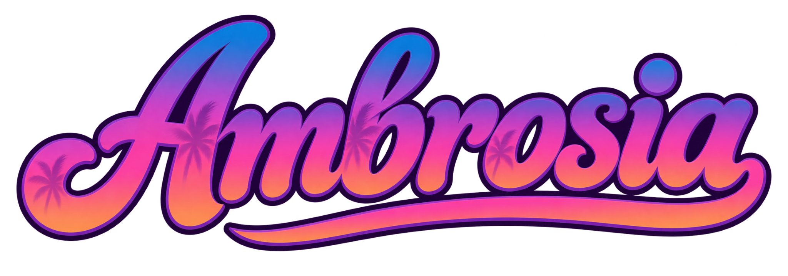

<h1 align="center">
  
</h1>

<p align="center"><strong>Preservation, open research, and a native PC runtime for GTA VI.</strong></p>

<p align="center">
  <a href="CHANGELOG.md"></a>
  <a href="ROADMAP.md"></a>
  <a href="LICENSE"></a>
</p>
<p align="center">
  <a href="runtime/README.md"></a>
  <a href="docs/ci-policy.md"></a>
  <a href="docs/ci-policy.md"></a>
  <a href="#project-status"></a>
</p>
<p align="center">
  <a href="tools/"></a>
  <a href="runtime/"></a>
  <a href="runtime/xma_decoder/"></a>
  <a href="https://discord.gg/xEaVQtW5jH"></a>
</p>

<p align="center">
  <a href="#project-status">Status</a> ·
  <a href="docs/README.md">Docs</a> ·
  <a href="CONTRIBUTING.md">Contribute</a> ·
  <a href="CHANGELOG.md">Changes</a> ·
  <a href="docs/i18n/README.md">Other languages</a>
</p>

Ambrosia is an independent open-source project working toward running the Xbox
Series version of GTA VI natively on PC. The goal is a working boot, interactive
menus, and stable gameplay. **We are not there yet.**

The CPU code is already x86-64. The runtime loads it and supplies the console
services it expects, while the shader tools translate RDNA2 GPU programs to
SPIR-V for Vulkan. Game files and generated outputs stay on the player's machine.

> [!IMPORTANT]
> This repository contains no original game files, game assets, keys, or prebuilt
> copy of the game. It does not provide instructions for obtaining them. Workflows
> that use the game require your own copy with files already readable on disk.
> Nothing here decrypts protected packages. Do not upload game files, extracted
> assets, generated shaders, or traces containing game content.

## Project status

**Experimental. No playable Ambrosia release or verified retail boot is claimed.**

| Area | What we can actually say |
|---|---|
| Local checks | 106 synthetic test methods passed on Linux with Python 3.12.3: 78 contributor checks, 22 import-readiness checks, and six launch-policy checks. |
| Runtime | PE loader, import shims, and a D3D12-to-Vulkan backend are present. The new strict import gate has generated-PE regression cases, but those Windows cases have not run. |
| Shaders and formats | Translation, archive, model, texture, and audio tools are inherited from earlier work. Their recorded measurements are not new Ambrosia validation. |
| Native builds | The renamed Windows runtime has not been build-verified locally. |
| CI and delivery | Windows/Linux contributor CI is configured but has not run on GitHub for Ambrosia. Extended builds are opt-in. No continuous deployment or release pipeline is configured. |
| Game and GPU | No Ambrosia menu, in-game rendering, performance, or stability result has been verified. |

The badges above describe this local state. They are not live GitHub build
results. See the [roadmap](ROADMAP.md), [CI policy](docs/ci-policy.md), and
[inherited technical notes](docs/README.md) for the detail behind it.

## 🧪 Contribute without game files

You can work on loaders, imports, streaming queues, format handling, diagnostics,
and synthetic tests without owning or downloading the game. Start with Python
3.12 or newer, from the repository root:

```sh
python -I ambrosia.py doctor
python -I ambrosia.py test --list
python -I ambrosia.py test
python -I tests/test_boot_readiness.py
python -I tests/test_ambrosia_launch.py
```

The doctor discovers prerequisites without running external tools or installing
anything. The contributor command runs 78 selected tests; the next two commands
cover the other 28. These are focused checks, not the full suite or a native
build. The commands do not provide an OS sandbox.

Use `test hashdict`, `test paths`, `test manifests`, `test console`, or
`test developer` to narrow the contributor selection. Doctor and contributor
commands support redacted `--json` reports. See the
[developer workflow](docs/developer-workflow.md) for examples.

## 🧩 How it works

| Part | Job | Read more |
|---|---|---|
| Package checks | Identify supported files using names, sizes, and hashes. | [Build entry point](make_game.py) |
| Shader tools | Unpack and translate native RDNA2 programs to SPIR-V. | [Translator contract](docs/design.md) |
| Runtime | Map PE images, resolve imports, supply offline services, and bridge console graphics to Vulkan. | [Runtime guide](runtime/README.md) |
| Format tools | Inspect and export supported archive, model, texture, and audio formats locally. | [Technical index](docs/README.md) |
| Diagnostics | Record startup events and assess initial import resolution without sharing raw traces. | [Import readiness](docs/import-readiness.md) |

A resolved import is not proof that a service behaves correctly. A translated
shader is not proof that a frame renders correctly. Progress means reproducing
results and fixing the next failure, not just increasing counts.

## 🛠️ Build and platform notes

Game-free contributor work needs Python, not a full asset export. Native runtime
work needs the toolchain described in [runtime/README.md](runtime/README.md).

For game-derived build experiments, the existing tooling targets Xbox Series
package version **1.0.2.1**. The main Windows prerequisites are Python 3.12+,
.NET 8 SDK, the Vulkan SDK, LLVM 21+ with the AMDGPU target, and Visual Studio
2022 C++ tools with Windows SDK **10.0.26100 or newer**. Asset tooling also needs
the pinned `rpf9-explorer` submodule; ffmpeg is used for XMA2 decoding.

`Build.bat` provides interactive setup. To choose the package and work locations
explicitly, use the terminal entry point:

```powershell
python -I make_game.py --game "D:\MyPackage" --check
python -I make_game.py --game "D:\MyPackage" --work "E:\ambrosia-work" --out "D:\Ambrosia" --stages check,shaders,runtime
```

These commands prepare experimental build outputs, not a playable release.
Full asset exports can take hundreds of GiB; the contributor checks above do
not need them. Keep package files read-only where possible and generated outputs
outside the repository. Shader fallbacks, hardware limits, and GPU test setup
are documented in [design notes](docs/design.md) and [testing](docs/testing.md).

### Running the loader on Linux

The runtime is Windows code. Existing cross-build and Wine/Proton paths are
research options, not verified Ambrosia game support. Linux can run the Python
tools and portable tests natively; macOS GPU experiments depend on its Vulkan
translation layer and have additional limits. See the
[runtime guide](runtime/README.md) and [testing notes](docs/testing.md).

## 🤝 What needs work

The next steps are a reproducible boot baseline, live DirectStorage queues,
console audio integration, CPU compatibility, and shader/memory correctness.
Stable gameplay also needs testing by people using their own copies on real
hardware. Synthetic checks alone cannot establish that.

Keep contributions small: one problem, clear acceptance checks, and enough
information to reproduce the result. Check for existing work before starting,
then follow [CONTRIBUTING.md](CONTRIBUTING.md). Join the
[Discord](https://discord.gg/xEaVQtW5jH) to coordinate.

## 📝 A note from the author

> I consider takedowns, meddling, or attempts to suppress this work aggression
> toward the open-source community. They reflect extremely poorly on the parties
> behind them. Ambrosia exists for preservation, the pursuit of knowledge,
> science, and making technology better for humanity. There are no original game
> files or game assets in this repository. Open research deserves room to exist.

## 🙏 Credits

Ambrosia is independently maintained. It builds on earlier Leonida work and the
people who created it. Their contributions, original notices, and technical
citations remain part of the project. See [UPSTREAM.md](UPSTREAM.md) for provenance.

- [rpf9-explorer](https://github.com/breadbbbb/rpf9-explorer) by breadbbbb: archive, model, texture, and audio decoding used by `tools/rpf9dump`.
- [Mesa](https://gitlab.freedesktop.org/mesa/mesa) (MIT): descriptor layouts and shader behavior references.
- [libHttpClient](https://github.com/microsoft/libHttpClient) (MIT), by Microsoft: the vendored XTaskQueue/XAsync implementation.
- [LLVM](https://llvm.org/): AMDGPU disassembly.
- [SPIRV-Tools](https://github.com/KhronosGroup/SPIRV-Tools): assembly and validation.
- Historical artwork reference: [SlyDevil's GTA VI icon](https://www.steamgriddb.com/icon/122618).

Grand Theft Auto and related names belong to their respective trademark owners.
Ambrosia is not affiliated with or endorsed by them.

## ⚖️ License

[GPLv3 or later](LICENSE). Third-party components keep their own licenses and notices.
